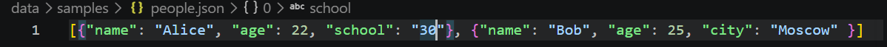
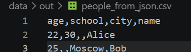
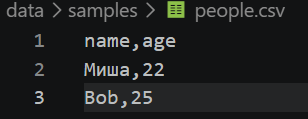
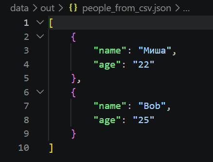
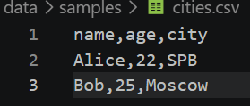
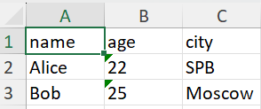

## Лабораторная работа №5
  
**Задание A — JSON ↔ CSV**  
*Файл*: [json_csv.py](json_csv.py)  
*Ввод*: {name1}.json / {name1}.csv
*Вывод*: {name2}.csv / {name2}.json
  
_Перевести из json в csv_
  
    
`json_to_csv('data/samples/people.json', 'data/out/people_from_json.csv')`  
  
  
---
  
_Перевести из csv в json_  
  
    
`csv_to_json('data/samples/people.csv', 'data/out/people_from_csv.json')`  
  

**Задание B — CSV → XLSX**  
*Файл*: [csv_xlsx.py](csv_xlsx.py)  
*Ввод*: {name1}.csv
*Вывод*: {name2}.xlsx
  
_Перевести из csv в xlsx_  
  
    
`csv_to_xlsx('data/samples/people.csv', 'data/out/people.xlsx')`  