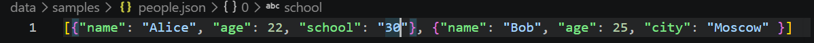
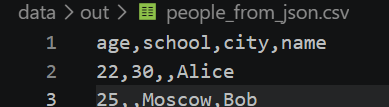
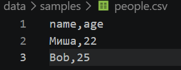
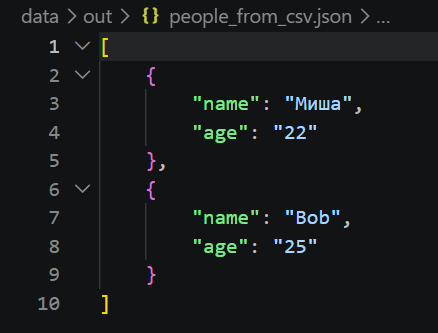
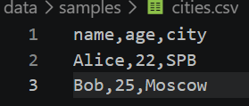
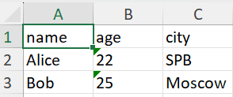

## Лабораторная работа №6  
  
**CLI‑утилиты с argparse**  
  
**Задание А — Подкоманды в одном CLI**  
*Файл*: [cli_text.py](src/lab06/cli_text.py)  
  
_**Анализ частот слов в тексте (stats)**_  
Анализ частоты слов в тексте с использованием функций из `lab03`.   
  
`python src/lab06/cli_text.py stats --input data/samples/text.txt --top 5`  
`python src/lab06/cli_text.py stats --help`  
  
---  
  
_**Вывод содержимого файла (cat)**_  
Построчный вывод содержимого файла с возможностью нумерации строк.  
  
`python src/lab06/cli_text.py cat --input data/samples/text.txt -n`  
`python src/lab06/cli_text.py cat --help`  
  
---  
  
**Задание B — Конвертер форматов**  
*Файл*: [cli_convert.py](src/lab06/cli_convert.py)  
  
_**Перевести из json в csv**_  
  
  
`python src/lab06/cli_convert.py json2csv --in data/samples/people.json --out data/out/people.csv`  
  
---  
  
_**Перевести из csv в json**_  
  
  
`python src/lab06/cli_convert.py csv2json --in data/samples/people.csv --out data/out/people.json`  
  
---  
  
_**Перевести из csv в xlsx**_  
Конвертация с использованием функций из `lab05`.  
  
  
`python src/lab06/cli_convert.py csv2xlsx --in data/samples/people.csv --out data/out/people.xlsx`  