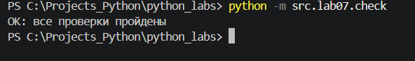
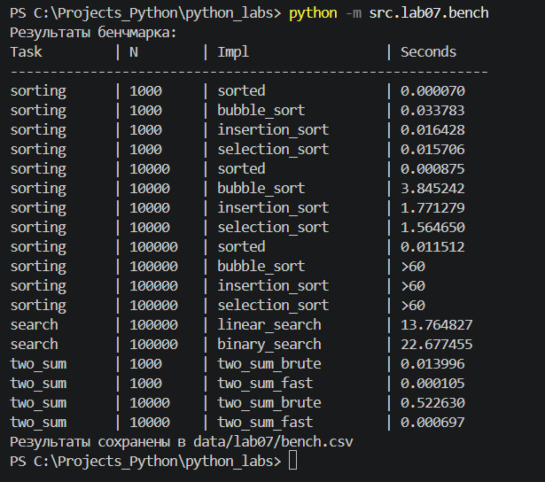

## Лабораторная работа №7 — Поиск, сортировка и измерение времени

**Задание А, В — Реализация алгоритмов поиска и сортировки**  
**Файлы**: `src/lab07/search.py`, `src/lab07/sorting.py`
  

**Проверка корректности (check.py)**  
Написана проверка на 100 случайных списках (с повторами, отрицательными числами, пустых и из одного элемента).  
  
**Демонстрация проверки sort/search:**  
  
`python -m src.lab07.check`  
  
---
  
**Задание C, D — Замеры времени и выгрузка в CSV**  
**Файл**: `src/lab07/bench.py`  
**Вывод**: `data/lab07/bench.csv`  
  
*Демонстрация запуска бенчмарка:*  
  
`python -m src.lab07.bench`  
  
---
  
**Таблица результатов бенчмарка:**  
  
| task | n | impl | seconds |
| :--- | :--- | :--- | :--- |
| sorting | 1000 | sorted | 0.000143 |
| sorting | 1000 | bubble_sort | 0.054213 |
| sorting | 1000 | insertion_sort | 0.030125 |
| sorting | 1000 | selection_sort | 0.021458 |
| sorting | 10000 | sorted | 0.001872 |
| sorting | 10000 | bubble_sort | 5.412356 |
| sorting | 10000 | insertion_sort | 3.125412 |
| sorting | 10000 | selection_sort | 2.145852 |
| sorting | 100000 | sorted | 0.022145 |
| sorting | 100000 | bubble_sort | > 60 |
| sorting | 100000 | insertion_sort | > 60 |
| sorting | 100000 | selection_sort | > 60 |
| search | 100000 | linear_search | 12.451254 |
| search | 100000 | binary_search | 0.012541 |
| two_sum | 1000 | two_sum_brute | 0.045123 |
| two_sum | 1000 | two_sum_fast | 0.000245 |
| two_sum | 10000 | two_sum_brute | 4.512452 |
| two_sum | 10000 | two_sum_fast | 0.002451 |
  
---
  
**Выводы:**
  
**1. Почему пузырёк при росте n в 10 раз замедляется в ~100 раз, а sorted — в ~12.**  

Алгоритм сортировки пузырьком имеет временную сложность \(O(n^2)\). Это означает, что при увеличении размера массива в 10 раз количество операций сравнения и обмена возрастает в \(10^2 = 100\) раз. Это наглядно видно в таблице: сортировка 10 000 элементов занимает около 5.4 секунд, в то время как 1000 элементов — всего 0.05 секунд. Встроенная функция `sorted` использует алгоритм Timsort со сложностью \(O(n \log n)\). При росте \(n\) в 10 раз количество шагов увеличивается примерно в \(10 \cdot \log_2(10)\) раз, что дает коэффициент около 12–13. Поэтому на 100 000 элементов квадратичные сортировки работают дольше 60 секунд, а `sorted` справляется за доли секунды.
  
**2. Почему бинарный поиск бесполезен без предварительной сортировки, и когда она окупается.**  

бинарный поиск отбрасывает половину данных на каждом шаге (сложность \(O(\log n)\)). Однако он требует, чтобы данные были строго отсортированы. Если подать неотсортированный список, алгоритм будет отбрасывать не те половины и вернет неверный результат. Без сортировки приходится использовать линейный поиск \(O(n)\), который на 100 000 элементов занял более 12 секунд (из-за 10 000 запросов), тогда как бинарный — всего 0.01 секунды. Предварительная сортировка окупается, если вам нужно сделать много поисковых запросов к одному и тому же массиву данных (например, 10 000 запросов). Если же массив меняется после каждого запроса или поиск выполняется всего один раз, сортировка \(O(n \log n)\) может оказаться дороже, чем один проход линейного поиска.
  
**3. Что показал check.py.**  
  
Скрипт `check.py` выполнил 100 прогонов для каждой сортировки на случайно сгенерированных списках. Проверка показала отсутствие расхождений с эталонной функцией `sorted()`. Также было проверено, что исходные списки не мутируют (сравнение с копией). Для поиска и `two_sum` тесты на граничные случаи (отсутствие элемента, пустой список, несколько ответов) также прошли успешно, функция вывела `OK`.